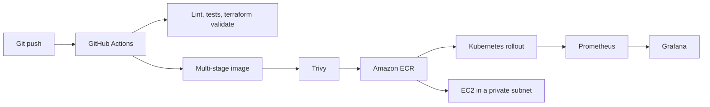

# KubeDeploy

KubeDeploy builds `orders-api`, scans the image, and ships it. Terraform creates the AWS network and a private EC2 instance. Kubernetes manifests run the same image on a cluster, and Prometheus and Grafana watch for 5xx spikes.

## Features

- GitHub Actions lints and tests, builds a multi-stage image that runs as uid 10001, and fails the job on fixable high or critical CVEs from Trivy.
- The deploy workflow pushes the image to Amazon ECR and rolls the Kubernetes deployment.
- Manifests include a Deployment, Service, Ingress, ConfigMap, and HPA. The Deployment has liveness and readiness probes, CPU and memory limits, and a rolling update with `maxUnavailable: 0`.
- Terraform modules create a VPC with public and private subnets, security groups, an EC2 instance, least-privilege IAM roles, and an ECR repository. Remote state is an S3 bucket with a DynamoDB lock, created by a small bootstrap stack.
- Prometheus alerts when the 5xx rate stays above 0.2 requests per second for two minutes. Grafana provisions the same condition and a small dashboard.

## Architecture



Terraform does not create the Kubernetes cluster. The manifests are applied to whatever cluster the kubeconfig points at, as long as the nodes can pull from ECR and the cluster has metrics-server (for the HPA) and an ingress class named `nginx`.

## Layout

```
kubedeploy/app/            orders-api, Dockerfile, unit tests
kubedeploy/k8s/            Deployment, Service, Ingress, ConfigMap, HPA
kubedeploy/monitoring/     Prometheus rules and the Grafana dashboard
kubedeploy/terraform/      bootstrap, modules, and the dev and local stacks
.github/workflows/         CI and the ECR / Kubernetes deploy
docker-compose.yml         API, Prometheus, and Grafana
```

## Run it locally

Python 3.12, Terraform 1.9, and Docker are enough. From a virtualenv:

```bash
python3 -m venv .venv
source .venv/bin/activate
pip install -U pip
pip install -r requirements-dev.txt
```

Copy `.env.example` to `.env` if you want to override the API port or readiness flag. The defaults are fine for a local run.

Start the API and the dashboards:

```bash
docker compose up --build
```

- API: http://localhost:8080/api/orders and http://localhost:8080/metrics
- A forced 500, used to exercise the alert: http://localhost:8080/api/diag/error
- Prometheus: http://localhost:9090
- Grafana: http://localhost:3000 (anonymous viewer). The orders-api dashboard is in the KubeDeploy folder.

The alert waits two minutes above the threshold, so a single 500 does not fire it. Prometheus evaluates `Http5xxSpike`. Grafana evaluates `orders-api 5xx spike`.

### Terraform

Format, init, and validate (no AWS account required):

```bash
./scripts/tf-validate.sh
```

The dev stack's backend is partial config, so the bucket name is not baked into the code:

```bash
cd kubedeploy/terraform/bootstrap
terraform init
terraform apply -var state_bucket_name=kubedeploy-tfstate-YOURNAME

cd ../envs/dev
cp backend.hcl.example backend.hcl
cp dev.tfvars.example dev.tfvars
# edit both files so the bucket name matches the bootstrap output
terraform init -backend-config=backend.hcl
terraform plan -var-file=dev.tfvars
```

`envs/local` points the AWS provider at LocalStack on port 4566 and turns NAT off. `terraform validate` works there too. An apply needs a LocalStack that implements the EC2 and IAM calls the modules use; treat that as a smoke target, not the production path.

GitHub Actions runs `fmt`, `init -backend=false`, and `validate` on every pull request. The plan job is `workflow_dispatch` on the CI workflow. It assumes `AWS_ROLE_ARN` and reads the state bucket from the `TF_STATE_BUCKET` repository variable.

The deploy workflow assumes the same role can push to ECR, then applies the `kubedeploy` kustomization with `KUBECONFIG_B64`. The image tag is the commit SHA.

## Tests

```bash
ruff check .
pytest
./scripts/tf-validate.sh
kubectl kustomize kubedeploy
docker build -t orders-api:local kubedeploy/app
trivy image --severity HIGH,CRITICAL --ignore-unfixed --exit-code 1 orders-api:local
```

`make test`, `make lint`, `make tf-validate`, and `make scan` wrap the same commands. Pytest covers the API routes, the 5xx counter, and the rendered manifests.

## Design decisions

The API is a small stdlib server plus `prometheus_client`. The path label is the route (`/api/orders/:id`, or `other`), not the raw URL. The image build installs dependencies in a builder stage and copies them into a runtime stage that drops to uid 10001. The root filesystem in Kubernetes is read-only; `/tmp` is an emptyDir.

Trivy is a gate, not a report. The workflow uses `--exit-code 1` for high and critical, and `--ignore-unfixed` so a CVE with no published fix does not block a release forever. ECR also scans on push. The runtime image upgrades Debian packages before that scan.

The VPC has two public and two private subnets. One NAT gateway sits in the first public subnet. That is cheaper than a NAT per AZ and is the thing I would change first for a production network. Instances do not get public IPs or SSH. The instance role can pull this ECR repository and start an SSM session. IMDSv2 is required. The security group allows 8080 only from the VPC CIDR, and egress is 443 plus DNS.

The GitHub deploy role can push to this repository and nothing else. `ecr:GetAuthorizationToken` is granted on `*` because the API does not accept a repository ARN. The Terraform role can touch the state bucket, the lock table, and the `kubedeploy-*` IAM names. A lot of `ec2:Create*` actions still have to be granted on `*` ; AWS does not support resource-level permissions for them. The first apply is done with an admin credential. After that, CI can assume the Terraform role.

Kubernetes manifests stay cluster-agnostic. Prometheus scrapes the Service directly, so the setup does not need the Prometheus operator.

## Configuration

See `.env.example`. Do not commit `.env`, `backend.hcl`, or `*.tfvars`. The example tfvars file is the template.
